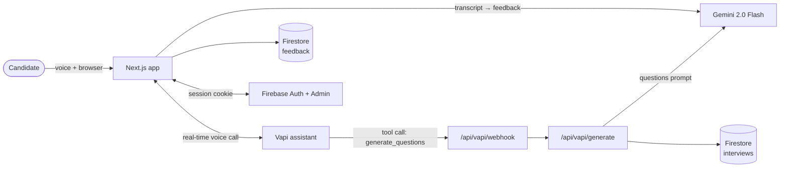

# PulseAI: High-Level Design

An AI mock-interview platform: a voice assistant asks you interview questions in real time, then an LLM scores the transcript and gives structured feedback. Live at [ai-interview-platform-pink.vercel.app](https://ai-interview-platform-pink.vercel.app). For code-level detail see the [Low-Level Design](lld.md).

## 1. System context

## 2. Components

| Component | Responsibility |
|---|---|
| Auth pages + `auth.action.ts` | Sign up, sign in, forgot password; Firebase ID token exchanged for a 1-week session cookie |
| Home | Your past interviews and the latest public interviews |
| Interview page + `Agent` | Starts the Vapi call, shows live transcript and speaking state |
| `/api/vapi/webhook` | Receives the assistant's `generate_questions` tool call and forwards it |
| `/api/vapi/generate` | Asks Gemini for questions and stores the interview |
| Feedback page | Shows scores, strengths, improvements and the final assessment |

## 3. Tech

| Layer | Choice |
|---|---|
| Framework | Next.js (App Router), React, TypeScript, server actions |
| UI | Tailwind CSS, shadcn/ui, sonner toasts, react-hook-form + zod |
| Voice | Vapi web SDK + server SDK |
| AI | Vercel AI SDK (`ai`, `@ai-sdk/google`), `gemini-2.0-flash-exp` |
| Data / auth | Firebase Auth, Firestore, Firebase Admin |
