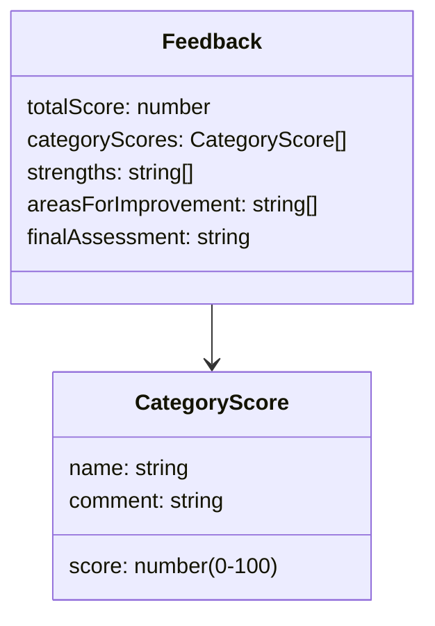
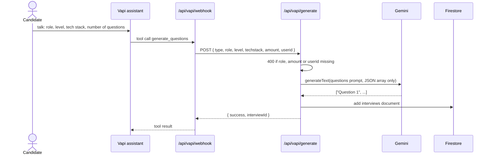
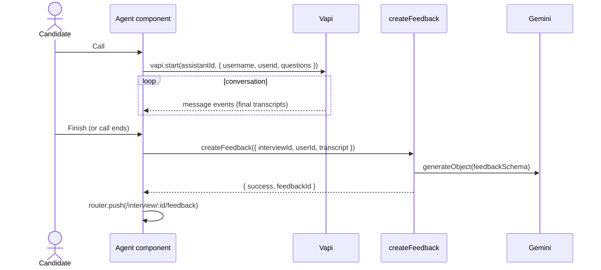

# PulseAI: Low-Level Design

For the big picture see the [High-Level Design](hld.md).

## 1. Firestore collections

| Collection | Document fields |
|---|---|
| `users` | name, email |
| `interviews` | role, type, level, techstack, questions[], userId, finalized, coverImage, createdAt |
| `feedback` | interviewId, userId, totalScore, categoryScores[], strengths[], areasForImprovement[], finalAssessment, createdAt |

## 2. Feedback schema (zod `feedbackSchema`)

The LLM is called with `generateObject({ schema: feedbackSchema })`, so the result always matches this shape.

## 3. Server actions

| Action | Behavior |
|---|---|
| `signUp`, `signIn`, `signOut` | Firebase user record; `setSessionCookie` creates a session cookie valid for one week |
| `getCurrentUser`, `isAuthenticated` | Verify the session cookie with Firebase Admin |
| `getInterviewsByUserId`, `getLatestInterviews`, `getInterviewById` | Firestore queries |
| `createFeedback` | Formats the transcript, calls `generateObject`, saves to `feedback` |
| `getFeedbackByInterviewId` | Loads feedback for the feedback page |

## 4. Interview generation

## 5. Interview and feedback

Feedback is generated once per call (guarded by a ref), whether the call ends on its own or the user clicks Finish.

## 6. Configuration

| Variable | Purpose |
|---|---|
| `NEXT_PUBLIC_VAPI_PUBLIC_KEY`, `NEXT_PUBLIC_VAPI_ASSISTANT_ID` | Vapi client and assistant |
| `NEXT_PUBLIC_BASE_URL` | Used by the webhook to call `/api/vapi/generate` |
| `GOOGLE_GENERATIVE_AI_API_KEY` | Gemini |
| `FIREBASE_PROJECT_ID`, `FIREBASE_CLIENT_EMAIL`, `FIREBASE_PRIVATE_KEY` | Firebase Admin (the web client config is in `Firebase/client.ts`) |
